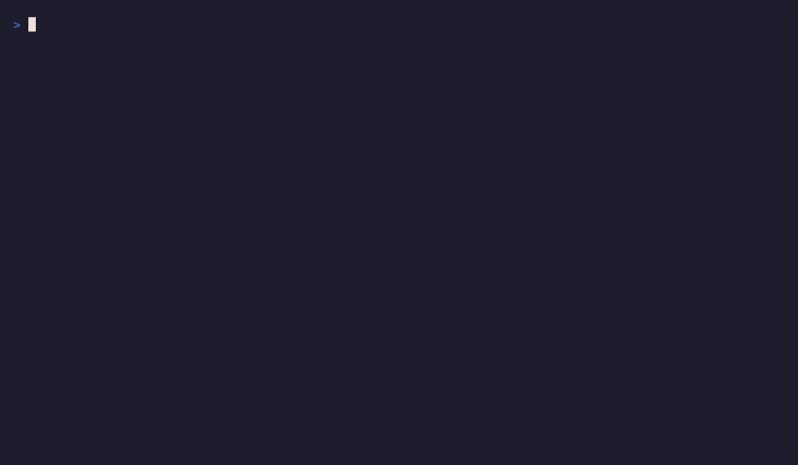
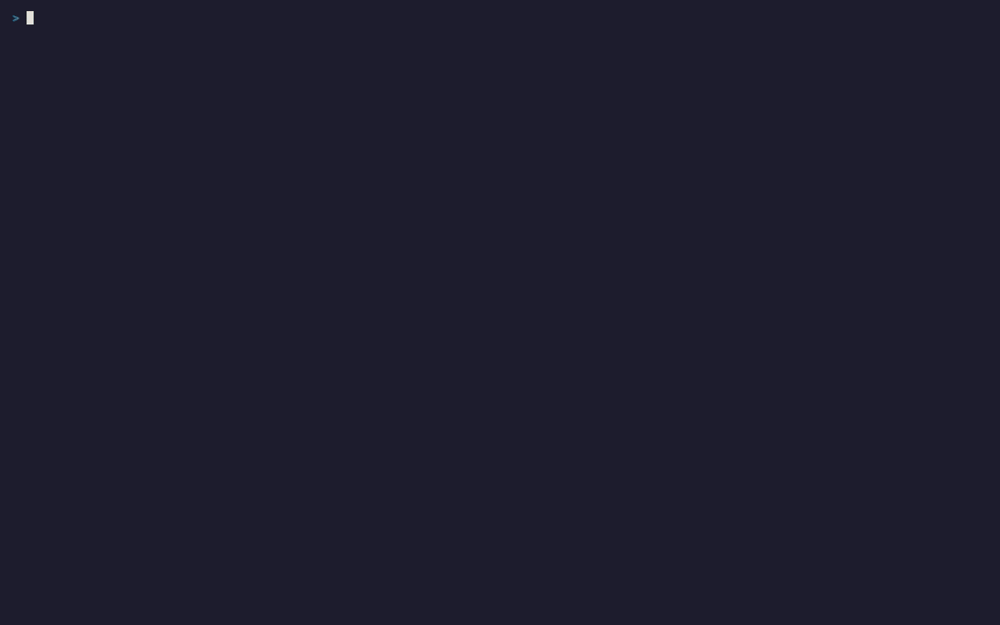

<!--
Copyright © Advanced Micro Devices, Inc., or its affiliates.

SPDX-License-Identifier: MIT
-->

# Getting started with ROCm CLI

## Quickstart

<!-- Step 1 and the closing paragraph are deliberate copies of the README text,
     with the cross-references retargeted to this site. The include between
     them uses the end of README step 1 and the start of its closing paragraph
     as anchors; edit both together. -->
These steps take a computer with a supported AMD GPU, running Linux, WSL2, or
Windows, from installing ROCm CLI to a chat reply from a model served on that
GPU. The first run downloads a lot: `rocm install sdk` fetches a ROCm runtime
and a PyTorch stack, and `rocm serve qwen` fetches a model of about 2.5 GB. Allow
time and disk space.

1. Install ROCm CLI with the command for your platform in
   [Installing ROCm CLI](install/installation.md). Then open a new terminal and
   confirm that `rocm version` prints the CLI version.

```{include} ../../README.md
:start-after: "`rocm version` prints the CLI version."
:end-before: "For other models and engine options, see"
```

For other models and engine options, see
[Configure ROCm and serve a model](#configure-rocm-and-serve-a-model) and
[Model serving](commands.md#model-serving).

The following recording shows the CLI inspecting the environment and chatting
with a locally served model:



## First run

```{include} ../../README.md
:start-after: "## First run"
:end-before: "## Interactive interfaces"
```

## Interactive interfaces

```{include} ../../README.md
:start-after: "## Interactive interfaces"
:end-before: "## Configure ROCm and serve a model"
```

The following recording shows the full-screen Console exploring simulated GPU
telemetry, model serving, and offline chat:



## Configure ROCm and serve a model

```{include} ../../README.md
:start-after: "## Configure ROCm and serve a model"
:end-before: "Running `rocm install sdk` when a"
```

<!-- The prose below is a deliberate copy of the README sentence, with the
     cross-reference retargeted to this site. The end of the sentence is then
     reused as the `:start-after:` anchor for the next include, which also
     matches the original sentence in README.md; edit both together. -->
Running `rocm install sdk` when a managed runtime is already the active default
asks first, because the new install takes over as the active default; see
[ROCm installation](commands.md#rocm-installation) for that gate, the flags
that approve it without a prompt, and the ROCm 10 and newer requirements.

```{include} ../../README.md
:start-after: "newer requirements."
:end-before: "You can also serve any compatible Hugging Face model directly"
```

You can also serve any compatible Hugging Face model directly. See
[Model serving](commands.md#model-serving) for the GGUF versus safetensors rule,
because which form works depends on the engine your GPU selects.

```{include} ../../README.md
:start-after: "form works depends on the engine your GPU selects."
:end-before: "## Commands"
```
